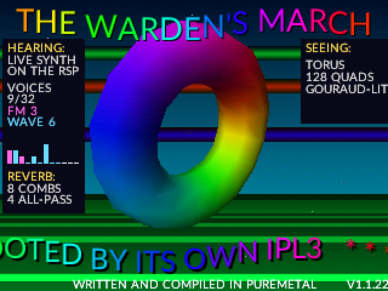
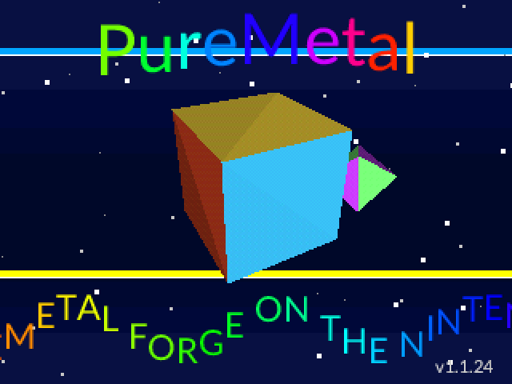
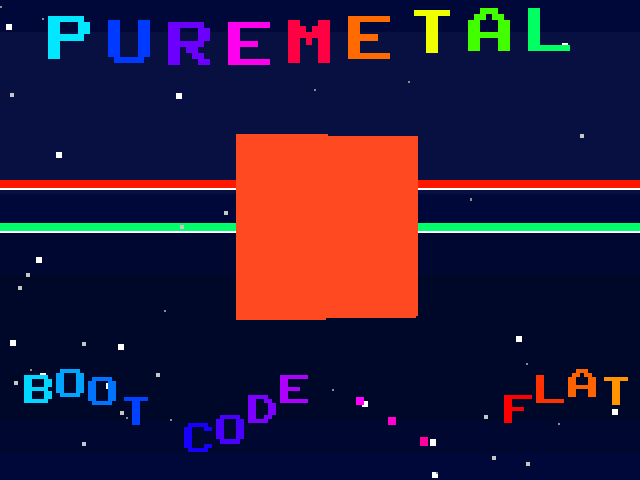
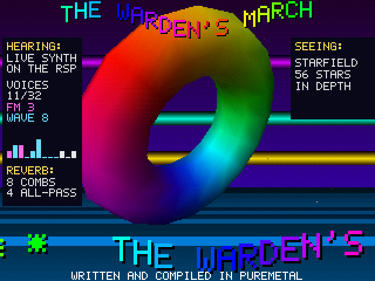
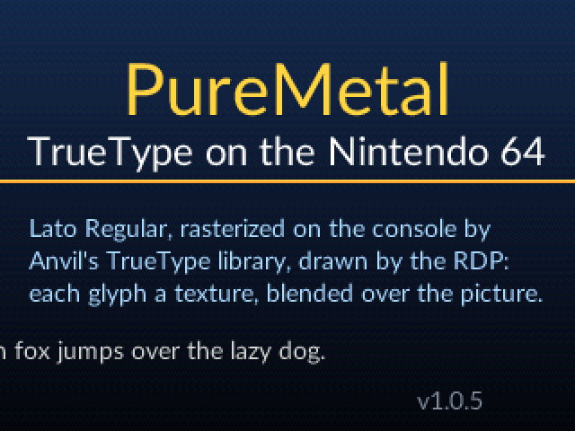
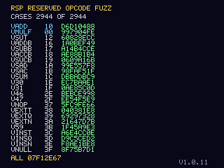

# PureMetal N64 Demo Cartridges

**Nintendo 64 homebrew demos written in PureMetal** - a BASIC-style language -
and compiled by **[PureMetal Forge](https://puremetalforge.ajtaji.com)**, an IDE
and compiler that builds straight to N64 machine code with its own boot code
(IPL3). Their text is **Lato**, converted to glyph pages and drawn by the RDP
through LibPureMetal64, the system library that ships with PureMetal Forge.

## The cartridges

Ready to play: download them from [`cartridges/`](cartridges) or from the
[Releases](../../releases) page.

| Cartridge | |
|---|---|
| [`PureMetalDemo.z64`](cartridges/PureMetalDemo.z64) | **PureMetal Demo** - the first PureMetal N64 demo. Copper bars, a three-speed starfield, a flat-shaded cube with an octahedron going round it, a colour-cycling title, a sine scroller, and a four-voice synthesiser (pulse lead, saw arpeggio, square bass, drums) playing an original tune - all on the VR4300 CPU, drawn by the RDP. |
| [`WardensMarchLive.z64`](cartridges/WardensMarchLive.z64) | **The Warden's March** - 60 frames a second: copper bars, a Gouraud-lit torus, a starfield and a sine scroller over the main theme of *Warden's Key*, played **live** - the game's sequencer and envelopes on the VR4300, every sample (4-operator FM, wavetables, noise, reverb, 48 kHz, up to 32 voices) on the **RSP**'s vector unit, which also turns, lights, sorts and sets up the torus's triangles between pieces of music. A panel names what you are hearing and what is being drawn. |
| [`TrueTypeDemo.z64`](cartridges/TrueTypeDemo.z64) | **TrueType on the Nintendo 64** - Lato Regular converted into glyph pages at build time, then drawn by the RDP as textures blended over the picture. The smallest example of text in a PureMetal cartridge. |
| [`RspFuzz.z64`](cartridges/RspFuzz.z64) | **RSP Reserved Opcode Fuzz** - not a demo but a measurement: it runs the RSP's 21 undocumented vector opcodes (and two known ones as a control) in all 16 element modes and two pipeline variants, 2944 cases, and records exactly what the hardware does. Done on VR4300 revision 1.0; **results from other CPU revisions wanted - see [below](#help-wanted-run-the-rsp-fuzz-cartridge-on-a-console).** |

### Playing them

The four carts are standard big-endian `.z64` images with a 6102-compatible
checksum and PureMetal Forge's own IPL3. They are made for Nintendo 64
hardware; elsewhere they display **THIS IS DESIGNED FOR HARDWARE ONLY** and
stop.

Each `.z64` in `cartridges/` has a signed catalog (`.cat`) beside it, signed
by PureMetal Forge.

## Help wanted: run the RSP fuzz cartridge on a console

The RSP's vector unit has 64 function codes and 21 of them are undocumented
(VSUT, VADDB, VSUBB, VACCB, VSUCB, VSAD, VSAC, VSUM, V30, V31, V46, V47, VNOP,
VEXTT, VEXTQ, VEXTN, V59, VINST, VINSQ, VINSN, VNULL). No game uses them.
`RspFuzz.z64` measures them: each opcode on four cases (edge values and random
ones) in every element mode, once on its own and once straight after a
multiply (the pipeline matters), recording vd, the whole accumulator before
and after, and VCO/VCC/VCE.

**Done on real hardware for VR4300 revision 1.0** (PRId `$0B10`): all 2944
cases ran on an NTSC console and gave `END EBAE6B50`. **Revision 1.0 results
are no longer needed.**

**What is wanted now: a run on any other CPU revision.** The cartridge shows
the revision at the bottom right of its screen, for example
`VR4300 PRId $0B10` over `revision 1.0`, and prints the same line first in
its log. If yours says anything other than revision 1.0, please run it.

**What it needs:** a console and a flash cartridge. It runs for about five
seconds and then shows each opcode's CRC-32, the total (`ALL`), and
**RESULTS SAVED** at the top right.

### Getting the results file from a SummerCart64

The cartridge writes its results to the cartridge's save memory (SRAM), and
the SummerCart64 stores that on the SD card as the cartridge's save file.

1. Copy `RspFuzz.z64` to the SD card, for example to its root folder.
2. Start the console, pick `RspFuzz.z64` in the SummerCart64 menu and run it.
3. Wait for the finished screen: `CASES 2944 OF 2944`, the `ALL` line and
   **RESULTS SAVED**.
4. Leave it a few more seconds - the SummerCart64 writes the save to the SD
   card about a second after the cartridge's last write - then switch off
   (or press Reset to go back to the menu).
5. On the SD card the file is `RspFuzz.sav`, in a folder named `saves` beside
   the ROM: with the ROM in the root folder, `/saves/RspFuzz.sav`. If the
   menu's saves-folder setting (`use_saves_folder` in its `config.ini`) has
   been turned off, it is `RspFuzz.sav` beside the ROM instead.

**With `sc64deployer`** (the SummerCart64's USB tool):

    sc64deployer upload RspFuzz.z64
    sc64deployer debug --isv 0x03FF0000 > rspfuzz-log.txt
    sc64deployer download save RspFuzz.sav

`upload` reads the save type (SRAM) from the ROM header. `debug` with the
IS-Viewer at ROM offset `0x3FF0000` captures the full log. Stop it once the
screen says RESULTS SAVED, then `download save` writes the results file.

**What to send back** (an [Issue](../../issues) is perfect):

- **`RspFuzz.sav`** - the results file.
- **A photo of the finished screen.**
- **The log**, if you captured one.

## Building them yourself

Use PureMetal Forge with its VR4300/RSP back end and LibPureMetal64 (it ships
with PureMetal Forge), Python 3 and Pillow for the font tool.

    python build.py --forge "path/to/PureMetalForge.exe" --output dist

Use `--font-tool path/to/pmfont.py` if it is outside the Forge installation's
`tools` folder. Use `--demo TrueTypeDemo` to build one cart; each folder's
`build.ps1` does the same for its own cart. Generated `.pmft` font assets stay
beside the source. Once generated, the same sources can be built in the IDE
with the Nintendo 64 board selected. The build number in each `version.n64`
advances on compile.

The programs include LibPureMetal64 by name: `Mips/Lib/LibPureMetalN64/lpm.n64`,
its font module, and `lpm_hwcheck.n64`, the startup hardware check. RspFuzz
also includes `lpm_fuzzrec.n64`, which writes its results file.

### What is in each demo's folder

| `PureMetalDemo/` | |
|---|---|
| `demo.n64` | the demo, in PureMetal |
| `demo_assets.n64` | its tables, generated - do not edit by hand |
| `make_demo_assets.py` | the generator of `demo_assets.n64` |
| `version.n64`, `build.ps1` | the version on screen; a headless build, not needed in the IDE |
| `Lato-Regular.ttf`, `OFL.txt` | the source font and its licence |

| `WardensMarch/` | |
|---|---|
| `wardens_march.n64` | the demo: the frame, the HUD, the torus's request to the RSP |
| `wk_player.n64` | the Warden's Key music engine's sequencer and envelopes, in PureMetal |
| `wk_rsp.n64` | the CPU's side of the RSP synthesiser: builds blocks, keeps it fed |
| `wm_rsp.n64` | the two RSP programs taking turns on one RSP |
| `wk_synth.rsp` | the synthesiser on the RSP's vector unit (FM, wavetables, noise, reverb) |
| `gfx_torus.rsp` | the torus on the RSP: turn, light, cull, sort, set up the triangles |
| `theme.wkmu` | the main theme of *Warden's Key* as the engine's data (tables, instruments, rows) |
| `wardens_assets.n64` | tables, generated by `make_assets.py` |
| `version.n64`, `build.ps1` | the version on screen (the build number is the compiler's: `@build`); a headless build, not needed in the IDE |
| `Lato-Regular.ttf`, `OFL.txt` | the source font and its licence |

| `TrueTypeDemo/` | |
|---|---|
| `truetype_demo.n64` | the template for a cartridge with text: the font and its licence beside the source, and the four lines marked `FONT` |
| `version.n64`, `build.ps1` | the version on screen; a headless build |
| `Lato-Regular.ttf`, `OFL.txt` | the source font and its licence |

| `RspFuzz/` | |
|---|---|
| `rsp_fuzz.n64` | the cartridge: the cases, the screen, the log and the results file |
| `fuzz.rsp` | the RSP side: runs the instruction under test on each case |
| `version.n64`, `build.ps1` | the version on screen; a headless build |
| `Lato-Regular.ttf`, `OFL.txt` | the source font and its licence |

The Warden's March build uses the committed `theme.wkmu` and assembles the
two RSP programs. The music comes from the author's game and is published here
with the demo.

## How they work

- **The CPU (VR4300)** runs the PureMetal program: MIPS III, 64-bit registers,
  compiled by Forge's VR4300 back end.
- **The RDP** draws everything: fill rectangles for the copper bars and stars,
  shaded triangles for the torus and the sky, and the text - each Lato glyph
  an 8-bit texture, loaded into TMEM and drawn by a texture rectangle, the
  colour blended by the glyph's coverage.
- **The text** uses Lato glyph sheets made by Forge's font tool. LibPureMetal64
  loads them from the cartridge and sends textured rectangles to the RDP.
- **The AI** plays 16-bit stereo from buffers the program keeps full. The
  Warden's March runs at 48 kHz.
- **The RSP** (in *The Warden's March*) is shared between two microcode
  programs - the music synthesiser and the torus - each put back on the RSP
  when it is its turn, with the music's state saved in between.

## License

MIT - see [LICENSE](LICENSE). **Lato** (`Lato-Regular.ttf`) is licensed under
the SIL Open Font License 1.1 - see `OFL.txt` beside each copy. It is included
unmodified.
