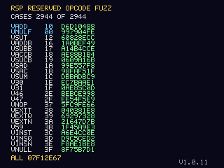

# PureMetal N64 Demo Cartridges

**Nintendo 64 homebrew demos written in PureMetal** - a BASIC-style language -
and compiled by **[PureMetal Forge](https://puremetalforge.ajtaji.com)**, an IDE
and compiler that builds straight to N64 machine code with its own boot code
(IPL3): no SDK, no libultra, no C.

## The cartridges

Ready to play: download them from [`cartridges/`](cartridges) or from the
[Releases](../../releases) page.

| Cartridge | |
|---|---|
| [`PureMetalDemo.z64`](cartridges/PureMetalDemo.z64) | **PureMetal Demo** - the first PureMetal N64 demo. Copper bars, a three-speed starfield, a flat-shaded cube with an octahedron going round it, a colour-cycling title, a sine scroller, and a four-voice synthesiser (pulse lead, saw arpeggio, square bass, drums) playing an original tune - all on the VR4300 CPU, drawn by the RDP. |
| [`WardensMarchLive.z64`](cartridges/WardensMarchLive.z64) | **The Warden's March** - 60 frames a second: copper bars, a Gouraud-lit torus, a starfield and a sine scroller over the main theme of *Warden's Key*, played **live** - the game's sequencer and envelopes on the VR4300, every sample (4-operator FM, wavetables, noise, reverb, 48 kHz, up to 32 voices) on the **RSP**'s vector unit, which also turns, lights, sorts and sets up the torus's triangles between pieces of music. A panel names what you are hearing and what is being drawn. |
| [`RspFuzz.z64`](cartridges/RspFuzz.z64) | **RSP Reserved Opcode Fuzz** - not a demo but a measurement: it runs the RSP's 21 undocumented vector opcodes (and two known ones as a control) in all 16 element modes and two pipeline variants, 2944 cases, and records exactly what the hardware does. **Help wanted from anyone with a console - see [below](#help-wanted-run-the-rsp-fuzz-cartridge-on-a-console).** |

### Playing them

They are standard big-endian `.z64` images (2-3 MB) with a 6102-compatible
checksum and their own IPL3. Load one in an N64 emulator the way you load any
`.z64`.

- **Tested on:** the PureMetal N64 emulator (the one these demos were developed
  on), 60 frames a second, sound at 48 kHz; and **ares v148** (paraLLEl-RDP),
  which boots them like a console would: through their own boot code.
- **Not yet tested on:** real hardware (a flash cartridge such as an EverDrive
  or SummerCart64). The boot block is signed for the 6102 CIC and initialises
  RDRAM, the caches and the PIF itself, as a console needs, so it should run;
  reports are welcome in [Issues](../../issues).
- **The boot code is the compiler's own**, in two stages, no Nintendo code: a
  signed first stage that never changes and a second stage in the cartridge.
- **The version is on screen**, bottom right (`V1.1.n`, `n` the build number:
  the compiler raises it on every build, in the IDE as on the command line -
  the `; @build` line in `version.n64`).

## Help wanted: run the RSP fuzz cartridge on a console

The RSP's vector unit has 64 function codes and 21 of them are undocumented
(VSUT, VADDB, VSUBB, VACCB, VSUCB, VSAD, VSAC, VSUM, V30, V31, V46, V47, VNOP,
VEXTT, VEXTQ, VEXTN, V59, VINST, VINSQ, VINSN, VNULL). No game uses them, but
emulators have to do *something*, and the two published hardware captures
already disagree about one of them (VNULL). `RspFuzz.z64` measures them: each
opcode on four cases (edge values and random ones) in every element mode, once
on its own and once straight after a multiply (the pipeline matters), recording
vd, the whole accumulator before and after, and VCO/VCC/VCE.

**What it needs:** a console and a flash cartridge. It runs for about five
seconds and then shows each opcode's CRC-32 on screen.

**What to send back** (an [Issue](../../issues) is perfect):

- **A photo of the finished screen.** The CRCs alone tell which emulator is
  right for each opcode.
- **Best: the full log.** The cartridge prints every case to the
  **IS-Viewer 64** debug port (`$13FF0000`). A **SummerCart64** can capture it
  over USB with its IS-Viewer emulation enabled (see `sc64deployer debug
  --help`; the IS-Viewer is at ROM offset `0x3FF0000`). The log is 2944 lines
  of `C <op> <element> <variant> <case> <input> <output>` and `END <crc>`.

**What the emulators say today** (the screen's CRCs; all other opcodes agree):

| | VNULL | ALL |
|---|---|---|
| PureMetal N64 emulator (krom's V073 capture: vd = vs, low accumulator 0) | `8F75B7D1` | `07F12E67` |
| ares v148 (and n64-systemtest's harness: nothing written) | `632AF2E6` | `EBAE6B50` |

`RspFuzz/rspfuzz_diff.py <console log> <emulator log> --show 5` compares two
logs case by case and prints the lanes that differ. The cartridge is fully
deterministic (a fixed seed), so the same build gives the same log everywhere.

## Building them yourself

You need **PureMetal Forge** - from the **Microsoft Store** (search for
"PureMetal Forge") or from **[puremetalforge.ajtaji.com](https://puremetalforge.ajtaji.com)** -
with its Nintendo 64 back end (the VR4300, and the RSP for *The Warden's
March*), and **Python 3** only if you change a demo's tables.

### In the IDE

1. Download or clone this repository:
   `git clone https://github.com/ajtaji/PureMetal-N64-Demo-Cartridges.git`
2. Start PureMetal Forge and open the demo with **File > Open...**:
   `PureMetalDemo/demo.n64`.
3. The `.n64` extension selects the target. Check the **Board** menu reads
   **Game consoles > Nintendo 64 (NTSC, 4 MB RDRAM)**.
4. **Compiler > Compile.** The Compiler Log ends with the assembler's success
   line, and the cartridge is written beside the source:
   `PureMetalDemo/demo.z64` (with `demo.bin`, the raw image, and `demo.bin.sym`,
   its symbols).
5. Run `demo.z64` in an emulator.

### From the command line

    cd PureMetalDemo
    PureMetalForge.exe --compile demo.n64 -o demo.bin

writes `demo.bin` and `demo.z64` the same way, without opening the IDE.
`PureMetalDemouild.ps1` does that and raises the build number in
`version.n64` first (the version the demo shows bottom right).

### Changing the tables

Everything the demo reads - the sine table, the 5x7 font, the note steps, the
tune and the scroller's message - is in `demo_assets.n64`, written by
`make_demo_assets.py`. Edit the Python (the song is a list of rows, the
message a string), then

    python make_demo_assets.py

and compile again.

### What is in each demo's folder

| `PureMetalDemo/` | |
|---|---|
| `demo.n64` | the demo, in PureMetal |
| `demo_assets.n64` | its tables, generated - do not edit by hand |
| `make_demo_assets.py` | the generator of `demo_assets.n64` |

The program starts with `XIncludeFile "Mips/Lib/n64.n64"`: the Nintendo 64
library that comes with PureMetal Forge (video and the RDP, audio, the
cartridge, the RSP), so nothing else is needed.

The cartridges in `cartridges/` were built by earlier versions of the
compiler; a build from this source today gives the same demo, not
byte-for-byte the same file.

| `WardensMarch/` | |
|---|---|
| `wardens_march.n64` | the demo: the frame, the HUD, the torus's request to the RSP |
| `wk_player.n64` | the Warden's Key music engine's sequencer and envelopes, in PureMetal |
| `wk_rsp.n64` | the CPU's side of the RSP synthesiser: builds blocks, keeps it fed |
| `wk_synth.rsp` | the synthesiser on the RSP's vector unit (FM, wavetables, noise, reverb) |
| `gfx_torus.rsp` | the torus on the RSP: turn, light, cull, sort, set up the triangles |
| `theme.wkmu` | the main theme of *Warden's Key* as the engine's data (tables, instruments, rows) |
| `wardens_assets.n64` | tables, generated by `make_assets.py` |
| `export_song.pb` | the exporter that wrote `theme.wkmu` from the game's own source (not needed to build) |
| `version.n64`, `build.ps1` | the version on screen (the build number is the compiler's: `@build`); a headless build, not needed in the IDE |

**Building *The Warden's March*:** open `WardensMarch/wardens_march.n64` in the
IDE and compile, or

    cd WardensMarch
    PureMetalForge.exe --compile wardens_march.n64 -o WardensMarch.bin

(or `build.ps1`). The two `.rsp` files are assembled by the compiler (the
`.rspfile` lines in `wk_rsp.n64` and `wardens_march.n64`) and put on the
cartridge with `theme.wkmu`. The music is the author's own game's; it is
published here with the demo.

## How they work

- **The CPU (VR4300)** runs the PureMetal program: MIPS III, 64-bit registers,
  compiled by Forge's VR4300 back end.
- **The RDP** draws everything: fill rectangles for the copper bars, stars and
  text, shaded triangles for the torus and the sky. Each frame's command list is
  built while the RDP draws the previous one.
- **The AI** plays 16-bit stereo at 48 kHz from buffers the program keeps full.
- **The RSP** (in *The Warden's March*) is shared between two microcode
  programs - the music synthesiser and the torus - each put back on the RSP
  when it is its turn, with the music's state saved in between.

## License

MIT - see [LICENSE](LICENSE).
